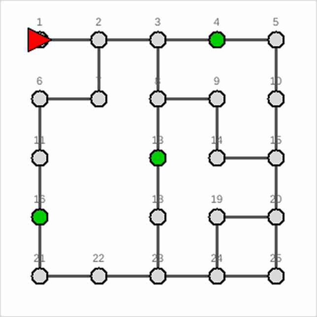
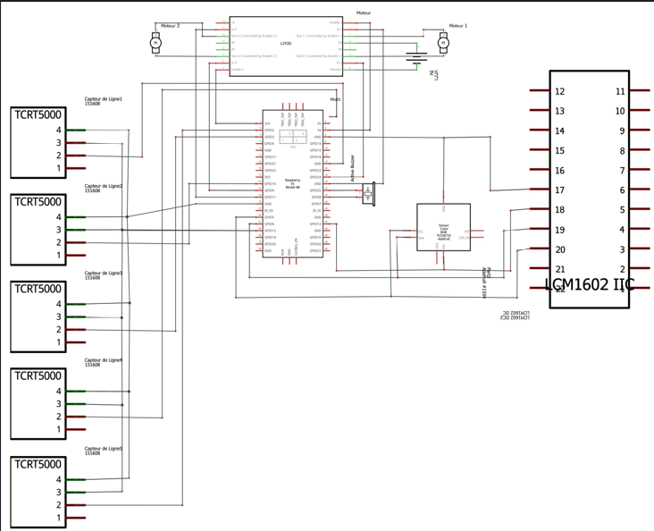
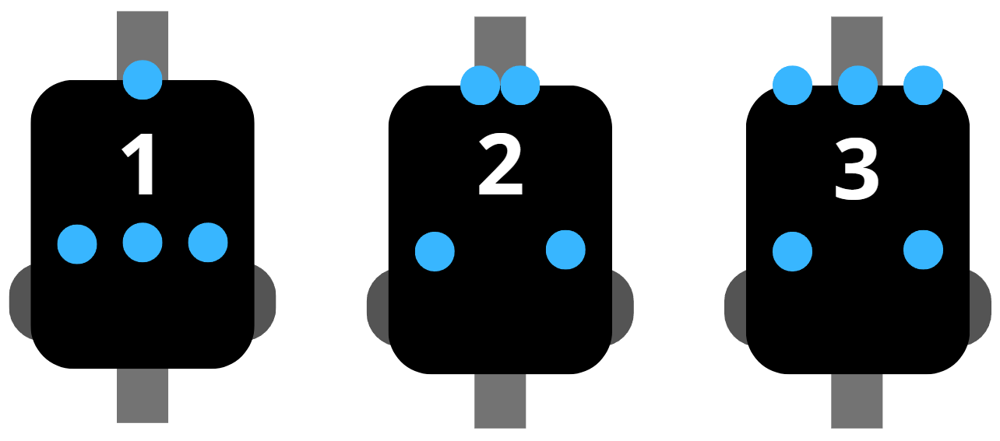

# PI Smart Robot — Robot autonome sur Raspberry Pi

Robot autonome qui lit le plan d'une ville, calcule son itinéraire, puis le parcourt en suivant des lignes noires au sol et en signalant les points de passage par un bip.

Projet d'intégration réalisé en équipe de 6 à l'INSA Rouen Normandie (2025-2026), codé en **C** sur **Raspberry Pi 4**.



*Simulation de l'itinéraire calculé par le programme `algo` : le robot (triangle rouge) passe par tous les points de passage (en vert), puis revient à sa case de départ.*

---

## Fonctionnement

```
plan de la ville (.txt) ──> [ algo ] recherche BFS ──> ordres AV / TG / TD ──> [ elec ] robot sur Raspberry Pi
```

1. **Lecture du plan.** Un fichier texte décrit la ville : une grille de cases, les passages entre les cases, la case de départ avec l'orientation du robot, et les points de passage.
2. **Calcul de l'itinéraire.** Le programme `algo` modélise la ville en graphe. Avec un parcours en largeur (BFS) sur les états du robot (position, orientation, points déjà visités), il cherche l'itinéraire qui passe par tous les points de passage puis revient à la case de départ.
3. **Génération des ordres.** Il écrit la liste des ordres : `AV` (avancer), `TG` (tourner à gauche), `TD` (tourner à droite).
4. **Exécution par le robot.** Le programme `elec` lit ces ordres et pilote le robot :
   - suivi de ligne avec 5 capteurs infrarouges TCRT5000 ;
   - détection des croisements ;
   - détection des pastilles de couleur avec un capteur RGB TCS34725 en I²C, avec un bip au buzzer ;
   - affichage des actions sur un écran LCD 16×2 en I²C.

Le script `run.sh` lance les deux programmes à la suite et mesure le temps d'exécution.

---

## Matériel

| Composant | Rôle |
|---|---|
| Raspberry Pi 4 | Cerveau du robot, GPIO et bus I²C |
| 5 × TCRT5000 | Capteurs infrarouges de suivi de ligne |
| TCS34725 (I²C) | Capteur de couleur RGB pour les pastilles |
| L293D + 2 moteurs DC | Pilotage des roues |
| Écran LCD 16×2 (I²C) | Affichage des actions en direct |
| Buzzer | Signal sonore sur les points de passage |





---

## Technologies

- **C** : structures de données (listes chaînées, tables de hachage, graphes), algorithme BFS
- **Raspberry Pi** : GPIO, bus I²C, bibliothèque wiringPi
- **Threads POSIX** (`pthread`, mutex)
- **Tests unitaires** avec CUnit (13 tests sur les structures de données et le robot)
- **Documentation** avec Doxygen, **rapport** en LaTeX
- **Bash**, **Makefile**, **Python** (Tkinter) pour la visualisation

---

## Essayer la partie algorithmique sans le robot

La partie algorithmique tourne sur n'importe quel PC Linux.

```bash
# Dépendances (Ubuntu / Debian)
sudo apt install gcc make libcunit1-dev python3-tk

cd programmes/algo
make bin/laby                   # compile le programme de calcul d'itinéraire
./bin/laby entree.txt           # affiche les ordres : AV, TG, TD...
make tests                      # compile les tests unitaires
./tests/test_labyrinthe && ./tests/test_robot
python3 visualizer.py           # visualise le parcours
```

---

## Organisation du dépôt

```
programmes/
├── algo/        Calcul d'itinéraire (BFS), structures de données, tests CUnit, visualiseur
├── elec/        Pilotage du robot : moteurs, capteurs, LCD, buzzer
└── run.sh       Lance les deux programmes à la suite
rapport/         Sources LaTeX du rapport
docs/            Rapport en PDF et images
```

📄 Le rapport complet (40 pages) est dans [`docs/rapport.pdf`](docs/rapport.pdf).

---

## Résultats

- Le calcul de l'itinéraire prend **60 ms** pour la ville de la démonstration.
- Le jour de la soutenance, le robot a parcouru **sans faute les 15 premières cases en 30 secondes** : bips sur les pastilles et affichage de toutes les instructions. Il n'a pas fini le parcours : à la sortie d'un virage, la ligne noire cachée par une pastille n'a pas été détectée. Le rapport détaille ce problème et les pistes pour le corriger.

---

## Équipe et contributions

| Membre | Rôle |
|---|---|
| **Hadi Assi** | **Conception électronique, câblage, soudure, perçage du châssis, tests des composants et programmes des composants** (capteur de couleur RGB et écran LCD en I²C) |
| Edouard Doubet | Conception électronique, câblage, tests et programmes des composants |
| Bréhan Eraud-Robert | Développement algorithmique, structures de données (TAD) |
| Célia Antunes | Développement algorithmique, structures de données (TAD) |
| Romain Leprevost | Développement du programme du robot, tests et ajustements |
| Adam El Marzouki | Gestion de projet |
